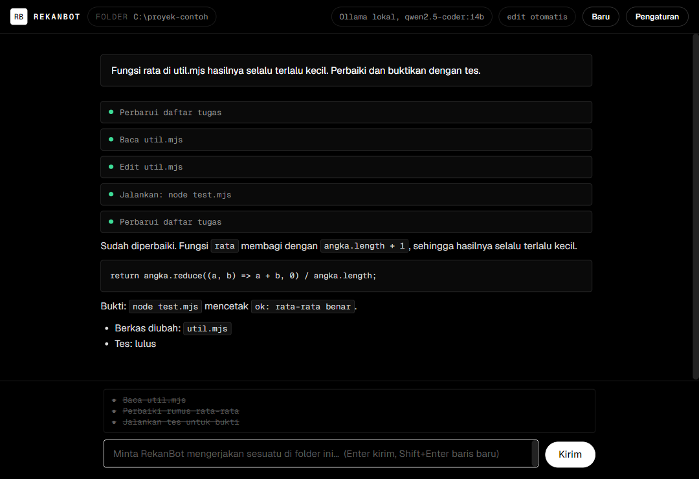
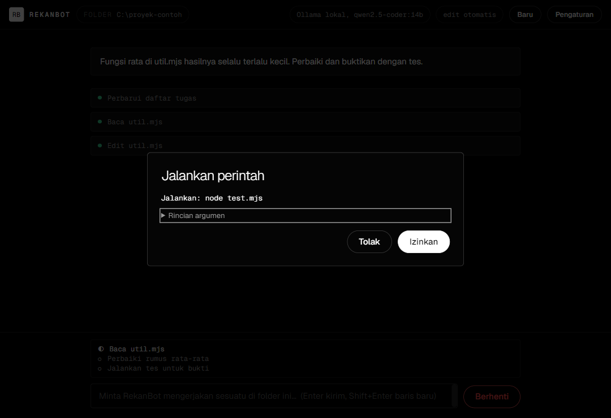
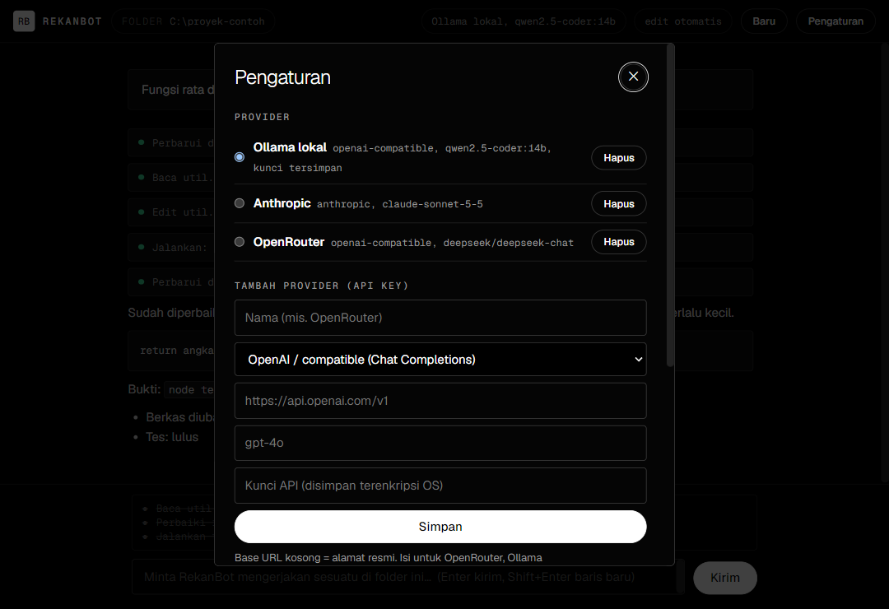

# RekanBot Open

Agen AI coding **open source**, ringan, bebas provider. Aplikasi desktop dengan installer, plus CLI. Versi open source dari RekanBot.

- **Ringan:** proses utama 35 KB dan antarmuka 10 KB (tanpa React); inti agen tanpa dependensi runtime.
- **Bebas provider:** OpenAI, Anthropic, endpoint compatible (OpenRouter, Ollama, LM Studio, dll.), Responses API, serta login langganan Claude dan Codex (eksperimental).
- **Alat sungguhan:** baca, tulis, edit, cari (glob/grep), shell, web, daftar tugas, sub-agen baca-saja, dan klien MCP (stdio + HTTP).
- **Aman secara bawaan:** semua jalur dikurung di folder kerja (termasuk symlink), tulis/shell/web minta izin, kunci disimpan terenkripsi OS, web fetch menolak alamat privat.

## Pratinjau

Panel desktop: agen membaca berkas, memperbarui daftar tugas, mengedit, lalu menjalankan tes sebagai bukti.



Perintah shell selalu minta izin (mode *edit otomatis* hanya mengizinkan tulis berkas tanpa tanya):



Provider, mode izin, dan login langganan diatur dari satu dialog; kunci API disimpan terenkripsi oleh OS:



Gambar dihasilkan oleh `node scripts/capture-preview.mjs` dari aplikasi sungguhan dengan server model tiruan (skenario tetap), bukan mockup.

## Pasang

Unduh `RekanBot-<versi>.msi` dari halaman Releases, cocokkan `.sha256`-nya, lalu jalankan (per-pengguna, tanpa admin). Installer belum ditandatangani kode, jadi SmartScreen dapat memperingatkan.
Pengembangan: Node 22+.

```
npm install
npm run verify          # baris ≤300, rahasia, tipe, 51+ tes
npm run build           # core + CLI + desktop
npm start -w @rekanbot/desktop
npm run dist -w @rekanbot/desktop   # bangun installer MSI + checksum
```

## Pakai

**Desktop:** pilih folder kerja, buka *Pengaturan*, tambah provider (API key) atau login, lalu minta sesuatu.
Mode izin: *tanya dulu* (disarankan), *edit otomatis*, *otomatis penuh*.

**CLI:**

```
rekanbot config add-provider --id lokal --kind openai-compatible --model llama3 --base-url http://localhost:11434/v1
rekanbot -p "tambahkan tes untuk src/util.ts" --provider lokal
rekanbot login claude          # EKSPERIMENTAL, baca docs/OAUTH.md
```

Tanpa konfigurasi, CLI memakai `ANTHROPIC_API_KEY` atau `OPENAI_API_KEY`. Mode non-interaktif (`-p`) menolak
alat berisiko kecuali `--yes`.

## Struktur

```
packages/core/   inti: provider, loop agen, alat, izin, OAuth, MCP, sesi, konfigurasi
packages/cli/    antarmuka terminal
apps/desktop/    Electron (main + preload + renderer vanilla TS)
scripts/         check-lines (≤300 baris/berkas), check-secrets, e2e-desktop
docs/OAUTH.md    parameter OAuth, sumber, dan risikonya
```

Aturan proyek: **maksimal 300 baris per berkas** dan **nol kredensial di repo**; keduanya dijaga skrip yang gagal
dengan kode keluar ≠ 0 dan dijalankan CI.

## Status pengujian (jujur)

| Bagian | Bukti |
|---|---|
| Alat, kurungan folder (termasuk symlink), loop agen, izin, kompaksi konteks | 51 tes otomatis lulus |
| Tiga provider (SSE, tool call, usage) | Teruji melawan server tiruan, **belum** melawan API asli |
| CLI | 5 tes proses nyata melawan server tiruan |
| Desktop | 19 pemeriksaan e2e dengan Electron nyata (kunci terenkripsi, dialog izin, tulis/tolak) |
| OAuth Claude/Codex | Alur dan pertukaran token teruji dengan token endpoint tiruan; **belum** dengan akun nyata |
| Installer MSI | Dipasang, dijalankan lewat e2e (19 lulus), lalu dicopot bersih di Windows 10.0.26300. Target NSIS **tidak dipakai**: pemasangnya crash di `System.dll` pada build Windows itu |
| CI GitHub Actions | `ci.yml`/`build.yml` ada, tetapi belum pernah berjalan: akun pemilik terkunci karena penagihan. Installer dibangun lokal dengan `npm run dist` |
| macOS/Linux | Kode lintas platform, **belum** diuji |

## Batasan yang diketahui

- `web_fetch` memeriksa alamat hasil DNS sebelum mengambil, tetapi serangan DNS rebinding (alamat berubah di antara dua pencarian) belum ditangani.
- Kurungan folder memeriksa symlink saat alat dipanggil; balapan symlink antara pemeriksaan dan pemakaian belum ditutup.
- Mode *otomatis penuh* menjalankan shell tanpa tanya: pakai hanya di folder yang aman dirusak.
- Installer belum ditandatangani kode. Windows 11 dengan *Smart App Control* aktif dapat memblokir aplikasinya ("An Application Control policy has blocked this file"): satu build uji di mesin pengembang diblokir, build sebelumnya tidak. Solusi tuntas: tanda tangan Authenticode.
- Alat MCP selalu diperlakukan berisiko (minta izin) karena efeknya tidak diketahui.
- `bash` memakai PowerShell di Windows dan bash di sistem lain; perintah tidak dijalankan di sandbox OS.

## Lisensi

MIT. Font Geist: SIL OFL 1.1 (lihat `apps/desktop/renderer/fonts/NOTICE.txt`).
